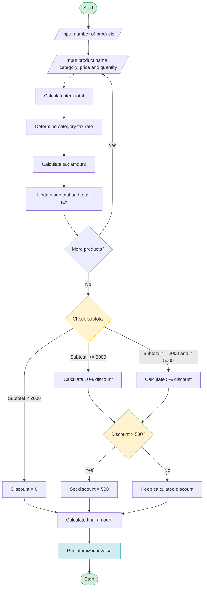

## 1. Problem Statement

Develop a Python program to generate an itemized retail invoice for multiple products. The program should calculate product costs based on quantities, apply category-specific taxes, provide discounts based on purchase thresholds, and enforce a maximum concession limit. Finally, it should display the complete bill with the total amount payable.

## 2. Objective

- Process multiple products and their quantities.
- Calculate the total price of each item.
- Apply different tax rates according to product categories.
- Apply discounts based on purchase amount.
- Ensure discounts do not exceed the maximum concession limit.
- Generate an itemized invoice.

## 3. Assumptions

1. Electronics products have a 10% tax rate.
2. Clothing products have a 5% tax rate.
3. Grocery products have a 2% tax rate.
4. Purchases of ₹5,000 or more receive a 10% discount.
5. Purchases of ₹2,000 or more receive a 5% discount.
6. Other purchases receive no discount.
7. The maximum discount allowed is ₹500.
8. The discount is calculated on the subtotal before tax.


## 4. Algorithm

1. Start.
2. Initialize the subtotal to zero.
3. Input the number of products.
4. For each product:
   - Input product name, category, unit price, and quantity.
   - Calculate the item total.
   - Determine the tax rate based on the category.
   - Calculate the tax amount.
   - Add the item total and tax to the invoice totals.
5. Check the subtotal and determine the discount percentage.
6. Calculate the discount amount.
7. Apply the maximum concession limit.
8. Calculate the final amount payable.
9. Display the itemized invoice.
10. Stop.
##mermaid

## 6. Sample Input

```
Enter number of products: 3

Product 1
Enter product name: Laptop
Enter category (electronics/clothing/grocery): electronics
Enter price: 40000
Enter quantity: 1

Product 2
Enter product name: Shirt
Enter category (electronics/clothing/grocery): clothing
Enter price: 1000
Enter quantity: 2

Product 3
Enter product name: Rice
Enter category (electronics/clothing/grocery): grocery
Enter price: 500
Enter quantity: 2
```

## 7. Sample Output

```text
========== RETAIL INVOICE ==========
Product      Qty   Price   Total    Tax%   Tax
Laptop         1 40000.00 40000.00   10% 4000.00
Shirt          2 1000.00  2000.00    5%  100.00
Rice           2  500.00  1000.00    2%   20.00
------------------------------------
Subtotal        : Rs. 43000.00
Total Tax       : Rs. 4120.00
Discount        : Rs. 500.00
Final Amount    : Rs. 46620.00
====================================
```


## 9. Test Cases

| Test Case | Subtotal | Expected Discount |
|---|---:|---:|
| 1 | ₹1,000 | ₹0 |
| 2 | ₹2,000 | ₹100 |
| 3 | ₹4,000 | ₹200 |
| 4 | ₹5,000 | ₹500 |
| 5 | ₹10,000 | ₹500 |

## 10. Conclusion

This project demonstrates how Python can be used to develop a retail billing system. It uses loops, conditional statements, arithmetic operations, and lists to process multiple products, calculate category-specific taxes, apply threshold-based discounts, enforce a maximum concession limit, and generate an itemized invoice.

**Technologies Used:** Python 3

